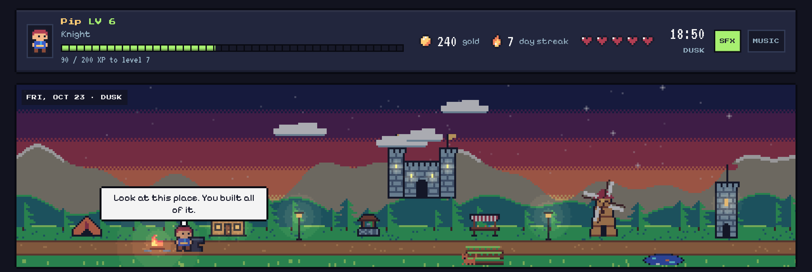
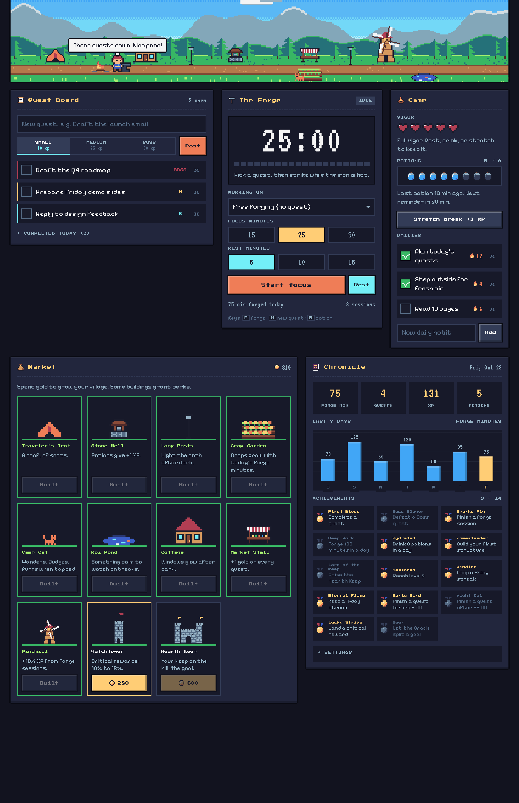
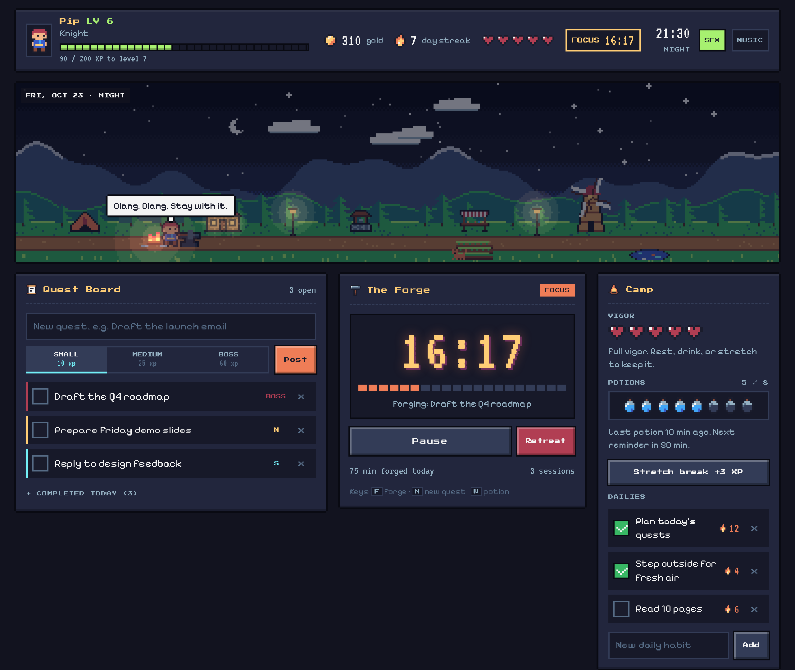
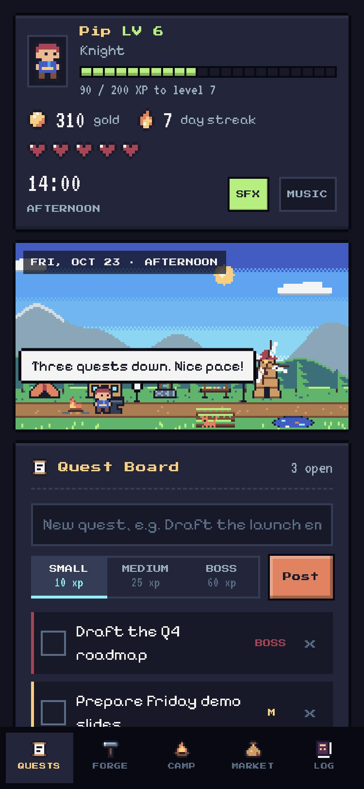
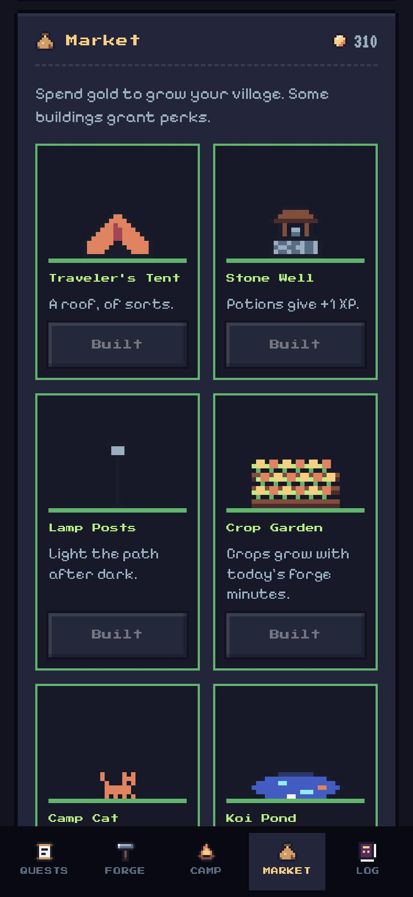

# Hearthforge

A retro pixel-art productivity RPG that lives in a browser tab. Your task list, focus timer, water reminders and rest breaks all feed one small village. Finish quests, forge focused work, drink water, and the village grows around a hero named Pip.

Everything is a single `index.html` file. No build step, no dependencies, no account.



## Why

A plain to-do list is easy to ignore. Hearthforge turns the boring parts of a working day into progress you can see: the sky follows your real clock, the garden grows with the minutes you focus, and the village fills in as you earn gold. It is made to stay open all day.

## Features

**Quest Board.** Post tasks as Small (10 XP), Medium (25 XP) or Boss (60 XP) quests. Completing one pays XP and gold, with a 10% chance of a critical reward that doubles both. Finished quests clear at midnight.

**The Forge.** A focus timer with 15, 25 and 50 minute sessions and 5, 10 and 15 minute rests. Link a session to a quest. Pip hammers at the anvil while you focus and sits by the fire while you rest. The countdown shows in the tab title, keeps time in a background tab, and asks the screen to stay awake while it runs.

**Camp.** Three small habits that keep you healthy:
- **Vigor hearts** drop the longer you go without a real break and refill when you rest, drink or stretch.
- **Potions** are glasses of water. Tap the bottles to log one. A reminder fires on an interval you choose.
- **Dailies** are repeating habits with streak counters.

**Market.** Spend gold on 11 buildings, from a tent to the Hearth Keep castle. Some give perks, such as extra gold per quest, more XP from focus sessions or better critical odds. The crop garden grows with the minutes you forged that day.

**A living village.** The sky, sun, moon and stars follow the real time of day. Lamp posts and windows glow at night, and some days it rains. Click Pip to chat, and click the cat when you have one.

**Chronicle.** Today's stats, a 7-day focus chart and 14 achievements.

**Extras.** Optional chiptune music and sound effects (all generated with the Web Audio API, no audio files), keyboard shortcuts and a phone layout with a bottom tab bar.

| Keys | Action |
| --- | --- |
| `F` | Start or pause the forge |
| `N` | New quest |
| `W` | Drink a potion |

## Screenshots

The screenshots use demo data.





<p>
  
  &nbsp;&nbsp;
  
</p>

## Run it

Open `index.html` in a browser. To serve it locally instead:

```bash
python3 -m http.server 8000
```

Then visit `http://localhost:8000`.

The pixel fonts (Pixelify Sans, Press Start 2P and VT323) load from Google Fonts. Offline, the page falls back to system monospace and sans-serif fonts and everything still works.

## How progress works

| Action | Reward |
| --- | --- |
| Small, Medium, Boss quest | 10, 25, 60 XP and 5, 12, 30 gold |
| Focus session | 1 XP per minute and 1 gold per 2 minutes |
| Potion | 2 XP and 1 gold |
| Stretch break (every 20 minutes) | 3 XP and 1 gold |
| Daily habit | 8 XP plus streak bonus (up to 10) and 4 gold |
| Achievement | 20 gold |

Level 2 needs 50 XP and each level after that needs 30 XP more than the last. Titles run from Peasant to Legend at level 25. A day counts toward your streak when you earn any XP.

## Your data

Progress is saved in your browser's `localStorage` under the key `hearthforge.v1`. Clearing site data erases it. Settings has a two-tap Reset save button.

## Optional features that need a host runtime

The page also contains code for features that only switch on when it is opened inside a host that provides the Claude artifact runtime (`window.claude`). In a plain browser they stay hidden or inactive and nothing else changes.

- **Cross-device save** through the runtime's document store.
- **Oracle** splits a big goal into smaller quests, and the **Bard** writes a four-line ballad about your day.
- **Notion Calendar** brings today's meetings onto the board as quests that pay XP when they end.

## Project layout

```
index.html      the whole app: markup, styles and script
docs/           screenshots used in this README
```

The pixel art is drawn in code from small character grids onto a canvas, so there are no image assets.
